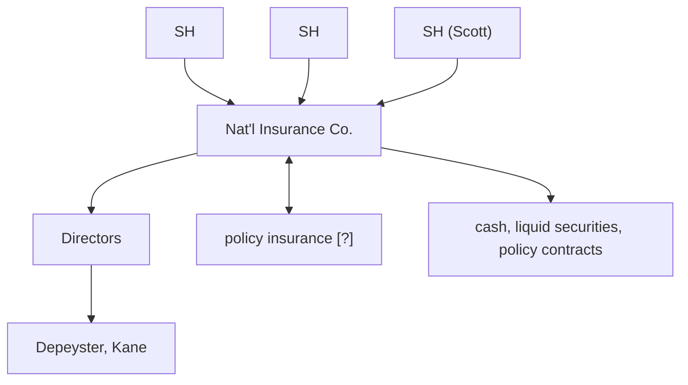

# BusOrg 4 — Early Charters (and Deference to Directors)

## Readings

- [[An Act to Incorporate the National Insurance Company]]
- [[Scott v. Depeyster (1832)]]

## Notes

- Corporations can only be created through an affirmative act (unlike GP, which arise naturally through common law).

### Incorporation and Powers/Flexibility

- 1800-1830: Incorporation - specific; Powers/Flexibility - narrow/inflexible governance parameters
- Problem: widespread corruption
- 1830-1880: Incorporation - general incorp. statutes (apply for charter under statute); Powers/Flexibility - narrow/inflexible terms (no subsidiaries)
- 1880-present: Incorporation - general; Powers/Flexibility - broad/flexible

### Sources of Law for Corporations

- Legal
    1. General incorporation statute - highest level of authority (DGCL)
    2. Charter / Certificate of Incorporation → issued by Sovereign
    3. Bylaws - rules to govern the corp.
- Equitable
    4. Fiduciary duties
- **Corp. Act is only valid when consistent with legal duties + Fiduciary duties**
- Court of law
    5. Quo Warranto - suit brought by AG [?] to dissolve corp. (misuse by directors) (rare)
    6. Ultra Vires - if corp. does something outside its powers, counter party can void respective contracts (rare due to broad power)
    7. **Shareholder Suits** (MAIN, threshold)

### [[Scott v. Depeyster (1832)|Scott v. Depeyster]]

- Suit in equity because court of law won't allow shareholder suits (theory is: can't sue yourself)
- If Scott (SH) asks for injunction on discounted notes → would probably have gotten it → anyone can hold corp. to its authorized powers

### Scott v. Depeyster printout - annotations

- Shareholder derivative suit

**Scott v. Depeyster parties**

- Next to ultra vires holding: → ≠ insurance (legal claim)
- Next to liability holding: → Directors acted in good faith (fiduciary duty claim)
- Equitable: Should they have appointed Kane?

1. Deference to Directors on duty of care
2. Care required: Expectations change with the times

### National Insurance Company charter printout - annotations

- Corporation directors wrote Charter and got Legislature to pass it.
- Next to § III (nineteen directors): → Directors must be from NY due to personal jurisdiction

### Presumed Powers of Corp.

1. Hold property
2. Sue/Be sued
3. Create contracts

Source photos: [[BusOrg 04 p1.jpg]], [[BusOrg 04 p2.jpg]], [[BusOrg 04 p3.jpg]]

## Signals

1. **Doctrine on the table:** Sources of law for corporations (DGCL, charter, bylaws; fiduciary duties); ultra vires, quo warranto and shareholder suits; Scott v. Depeyster
2. **Hypo, and what he was fishing for:** —
3. **Pushback on a student:** —
4. **What he called the hard case:** —
5. **What he said doesn't matter:** —
6. **Exam signal:** —
