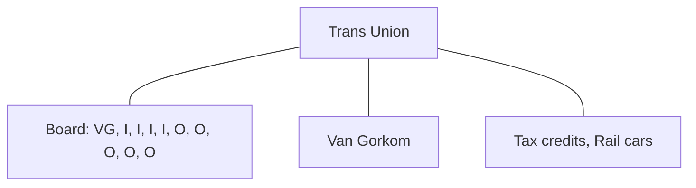

# BusOrg 6 — Modern Deference

## Readings

- [[Shlensky v. Wrigley (1968)|Shlensky v. Wrigley]]
- [[Smith v. Van Gorkom (1985)|Smith v. Van Gorkom]]
- 8 Del. C. 102(b)(7) → [[Aiding and abetting a fiduciary breach - knowing participation]], [[Charter exculpation of director liability]], [[Cleansing by stockholder vote - Corwin and the fully informed vote]]

## Notes

### Capital lock-in and cost of equity

- Low capital lock in = cost of equity being high (investors scared their money will disappear)
- High capital lock in = cost of equity also being high (very hard to get money out of corp.)

### 3 remedies stockholders have to constrain Corp

1. Lawsuit
    - Legal theory - Directors exceeding bylaws / charter / statutes (dying re… [?])
    - **Equitable theory - Fiduciary duties** (duty of care / duty of loyalty)
2. Sale
3. Vote

### [[Shlensky v. Wrigley (1968)|Shlensky v. Wrigley (1968)]]

- Shlensky brings stockholders derivative suit against CNLBC's [?] directors
    - Violation of **duty of care** claim
        - **Shlensky is not saying there's a conflict of interest that Wrigley is acting for himself. Instead, he's saying Wrigley isn't making a good decision to maximize profits.**
    - Board cares about other things besides making money
- [[Business judgment rule - scope of protection|BJR]] - In the absence of fraud, illegality, or conflict of interest, Director's decision is presumed to be a valid informed decision in good faith
- Did the Court think Wrigley satisfied duty of care?
    - No, Court did not comment on duty of care claim
    - [[Business judgment rule - scope of protection|BJR]] is a standard of review
    - Care / Loyalty - standard of action / conduct [?]
- **Likely no duty to maximize Corp's profits**

### [[Smith v. Van Gorkom (1985)|Smith v. Van Gorkom (1985)]]

- "Anti-Canon" of corporate law
- **Duty of care claim (process-driven = successful)**
- **Imperial CEO → controls who is on the Board (popular in the 1980s-1990s)**

**Trans Union**

- Tax credits drove merger
- Shareholders must vote before a company is sold
    - (?) is this true even when there is a controlling stockholder (?)
- **Why isn't Van Gorkom the best person to decide the price? After all, hasn't he been CEO and been on the board for a while?**
    - $55 isn't the problem, it's the informality of how the merger price was reached

### Remedy

- Equitable remedy that can impact 3rd parties ([[Detroit Lions v. Argovitz (1984)|Argovitz]])
    - Margin note: Duty Argovitz connected? [?]
    - Damages paid individually by Directors
- No self-dealing / duty of loyalty breach → no director is making more by the decision to sell at X price

### Duty of care breach

- Supreme Court chooses not to apply BJR because there was such an egregious dereliction of duty
- No one likes this outcome → Directors got a premium on the $33-40 per share at $55 per share and still was ordered to pay $25 million in damages

### Fix

- [[Charter exculpation of director liability|102(b)(7)]] → exculpates directors from monetary damages for duty of care violations
- Monetary liability? → must plead duty of loyalty

Source photos: [[BusOrg 06 p1.jpg]], [[BusOrg 06 p2.jpg]]

## Signals

1. **Doctrine on the table:** BJR as standard of review (Shlensky); duty of care and process in Van Gorkom; 102(b)(7) exculpation
2. **Hypo, and what he was fishing for:** —
3. **Pushback on a student:** —
4. **What he called the hard case:** —
5. **What he said doesn't matter:** —
6. **Exam signal:** —
