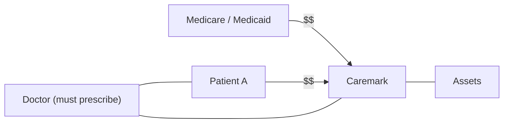

# BusOrg 8 — Good Faith and Oversight

## Readings

- [[In re Caremark International Inc. Derivative Litigation (1996)|In re Caremark International Inc. Derivative Litigation]]
- [[Marchand v. Barnhill (2019)|Marchand v. Barnhill]]
- [[Segway Inc. v. Cai (2023)|Segway Inc. v. Cai]]

## Notes

- **Always start with asking who is on the Board (if mentioned)**
    - No mention = Director conflict w/ others not in question

### [[In re Caremark International Inc. Derivative Litigation (1996)|Caremark (1996)]]

**Caremark payment structure**

- Kickbacks to doctors are highly incentivized by this 3rd party structure

### How is this duty of loyalty? (starred twice)

- Starts as a lack of oversight claim (evidencing lack of "good faith")
- Usually obligation of loyalty is limited to lack of self-interest
- No duty of care, since exculpation under 102(b)(7) = no monetary liability for DoC breach

### Why settle w/o a monetary settlement?

- Settlement included attorneys' fees (Corp.'s money; NOT individual Directors' $$)
- Res judicata → can't bring the same suit again
- Defense lawyers: want to pay off plaintiff's lawyers, so there is no individual liability to the plaintiffs themselves
    - → this is the story behind procedural posture
- Judge thoughts on settlement: is there even a duty of oversight? Has some merit / some non-merit. Settlement approved.

### Stone v. Ritter

- Duty of oversight → duty of loyalty
    - Gets there using "good faith" and lack of diligence to plead duty of care.
- **Caremark is not about protecting investors** (they are aligned with Board practices); it's a **public practice doctrine**.

### Massey Coal

- Duty of oversight is about violations of positive law (criminal and regulatory law) and attempts to get corporations to adhere to that law.
    - Think ARPL in Caremark (goal: prevent violation of kickbacks to physicians)
- **Caremark governs Director / public relationship rather than Director / shareholder relationship.**
    - So why is this a corporate right? Remains a puzzle.
    - DE wants to uphold positive law through corporate law

### [[Marchand v. Barnhill (2019)|Marchand (2019)]]

- [[In re Caremark International Inc. Derivative Litigation (1996)|Caremark]] claim successfully pleaded and survived
- Shows evolution of Caremark claim

### [[Segway Inc. v. Cai (2023)|Segway (2023)]]

- VP of Finance (officer) sued by **Corporation** for incorrectly keeping books
    - Segway asserts fiduciary duty that officer owes fiduciary duty.
    - Under agent-principal theory, **all officers ("agents") have a fiduciary duty to principal.**
- Although duty of oversight applies to officers (McDonalds), it did not reduce pleading standard

Source photos: [[BusOrg 08 p1.jpg]], [[BusOrg 08 p2.jpg]]

## Signals

1. **Doctrine on the table:** Oversight liability: Caremark, Stone v. Ritter, Massey Coal, Marchand; officer duties in Segway
2. **Hypo, and what he was fishing for:** —
3. **Pushback on a student:** —
4. **What he called the hard case:** —
5. **What he said doesn't matter:** —
6. **Exam signal:** —
