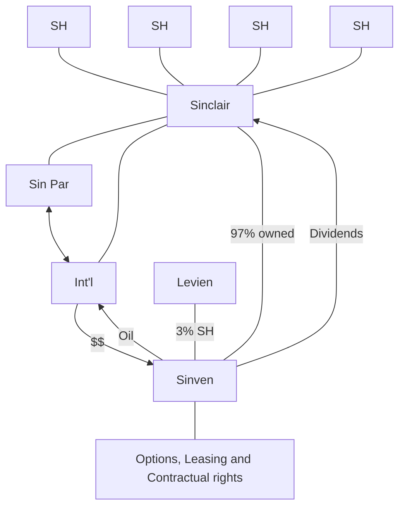

# BusOrg 9 — Controlling Stockholders

## Readings

- [[Sinclair Oil v. Levien (1971)|Sinclair Oil v. Levien]]
- [[In re Tesla Motors (Tesla 1) (2018)|In re Tesla Motors (Tesla 1)]]

## Notes

- Ordinarily, shareholders don't owe a duty
    - Don't control corp.'s assets
- Unless they are a **controlling** stockholder → [[Controlling stockholder safe harbours - 144(b) and (c)|144(c)(2)]]

### [[Sinclair Oil v. Levien (1971)|Sinclair Oil v. Levien (1971)]]

**Sinclair corporate structure**

- **Duty of loyalty claim - Sinven**
    1. Excessive dividends (marked ✗)
    2. Opportunities inhibited (marked ✗)
    3. Contractual breaches (marked ✓)
    - Margin note beside the claims cut off at page edge: "← co…" [?]
- Why have separate Int'l and a local groups of companies?
    - Tax benefits with localized production / international sale
- Sinven issuing dividends to Sinclair!
    - Board issues dividends
    - Directors of local branches → likely Sinclair in-house lawyers
- Levien (shareholder) sued on behalf of Sinven; sued Sinclair directly rather than the Board of Directors
    - Sinclair = controlling stockholder (SH v. SH)
    - Levien = stockholder
- Controlling stockholder owes fiduciary duties
    - Practically the stockholder that controls = control over Directors

### Sinclair v. Levien (cont.) - self-dealing / breach of loyalty claim

- "Tunneling" → Sinclair moves assets from Sinven (97%) to itself (100%)
    - But countervailing forces: Sinclair already owns 97% of Sinven → Sinclair is hurting itself a lot anyway. It's a diminishing curve after ~51% in terms of tunneling claims.

1. Excessive dividends
    - Payments were paid pro-rata; motives don't matter.
    - Self-dealing claims need pecuniary advantage to one person at the expense of another SH.
2. Opportunity
    - No actual opportunity actually came to Sinven → hard to define opportunity (**See [[Meinhard v. Salmon (1928)|Meinhard]]**)
3. Contracting breaches
    - There was self-dealing, even though contract didn't need to exist (weird)
    - Seems de minimis

### [[In re Tesla Motors (Tesla 1) (2018)|Tesla Motors 1 (2018)]]

- Solar City stock ownership
    - 22% owned by Musk; other Tesla SH own Solar City
- Tesla shareholders sue Tesla BoD and Elon individually (as a controlling stockholder)
    - Controlling stockholder analysis → sliding scale below 50% control.
    - Why Elon gets a non-ratable benefit from acquisition?
    - How does this compare with Sinclair?

Source photos: [[BusOrg 09 p1.jpg]], [[BusOrg 09 p2.jpg]]

## Signals

1. **Doctrine on the table:** Controlling stockholder fiduciary duties; Sinclair v. Levien self-dealing claims; Tesla 1 controlling stockholder analysis
2. **Hypo, and what he was fishing for:** —
3. **Pushback on a student:** —
4. **What he called the hard case:** —
5. **What he said doesn't matter:** —
6. **Exam signal:** —
