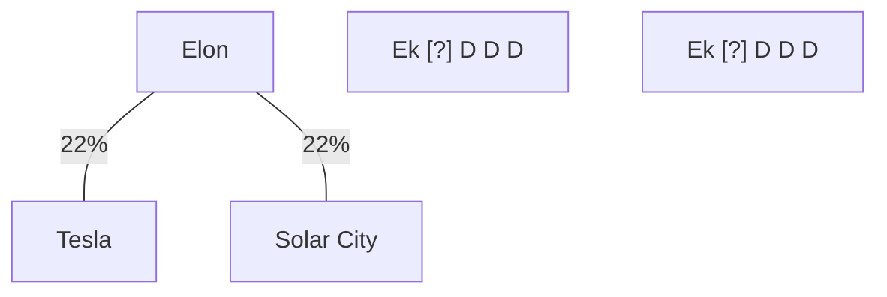

# BusOrg 10 — Controlling Stockholders

## Readings

- [[In re Tesla Motors (Tesla 2) (2022)|In re Tesla Motors (Tesla 2)]]
- 8 Del. C. 144(b),(c),(e)(1),(2),(3) (post-SB 21) → [[Cleansing by stockholder vote - Corwin and the fully informed vote]], [[Controller buyouts - the MFW dual protection structure]], [[Controlling stockholder safe harbours - 144(b) and (c)]]

## Notes

### [[In re Tesla Motors (Tesla 2) (2022)|Tesla 2]]

**Elon's stakes in Tesla and Solar City**

### Office Hrs

- **How are disinterested stockholders established in practice?**
- **If Elon not CS → case on cleansing under §144(a) based on interested transaction**
    - [144(a) vs 144(b)]
- How much should we know of the history of the law / not current law (SB-21)

### Elon in the room

- Why was Elon in the room when deal was being discussed (if he's recused himself)? Pushes coercion and reduces the risk of holdout; subtle coercion
    - Buccola: if you recuse yourself, you shouldn't be in the room

### Deal facts

- Full board of non-recused people delegated one non-conflicted Tesla director to run the deal (stock acquisition).
- Tesla and Solar City disinterested stockholders both approved the deal
- Tesla stock went from $180 → $900 after the stock acquisition of Solar City → this is why there is a lawsuit by Tesla shareholders
    - Wildly overpaid acquisition

### Step-by-step

1. Does [[Business judgment rule - scope of protection|BJR]] apply?
    - **Is Elon a controlling stockholder? If no, case dismissed**
        - Not directly decided
    - Is the rest of the Directors interested? Material relationship?
2. If no BJR, Entire fairness
    - Fair price, fair dealing

### Class 10 (cont.)

- Only act [?] of loyalty breach has to affect director disproportionately, compared to rest of stockholders

### Tesla 2 outcome

- Process was not great, price was fair → entire fairness passed.
- Question on if Elon was a controlling stockholder at 22% → not decided.
    - **SB 21 later established that definition under §144(c)(2) [minimum of 1/3]**

### Options if there's a controlling stockholder (post SB 21)

1. Cleanse
    - 144(b)(1) - independent committee of Directors (all disinterested) OR
    - 144(b)(2) - majority of disinterested stockholders

### Options after Tesla 2 (before SB 21) [from judge's opinion]; case law

1. Cleanse:
    - Delegate ab initio to a committee
    - b) entirely disinterested, independent directors
    - c) authorized to say no
    - d) majority votes yes
2. Ratification by stockholders (fully informed, uncoerced stockholders); majority of minority (disinterested stockholders)

- If transaction is a go-private deal / freeze-out merger: need both of ① committee + ② ratification by stockholders

Source photos: [[BusOrg 10 p1.jpg]], [[BusOrg 10 p2.jpg]]

## Signals

1. **Doctrine on the table:** Tesla 2: BJR vs entire fairness; cleansing options for a controlling stockholder transaction, before and after SB 21
2. **Hypo, and what he was fishing for:** —
3. **Pushback on a student:** —
4. **What he called the hard case:** —
5. **What he said doesn't matter:** —
6. **Exam signal:** —
