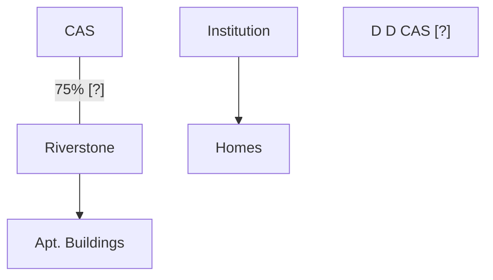

# BusOrg 11 — Direct and Derivative Claims

## Readings

- [[Tooley v. Donaldson, Lufkin & Jenrette (2004)|Tooley v. Donaldson, Lufkin & Jenrette]]
- [[In re Riverstone National (2016)|In re Riverstone National]]
- Del. Ct. Ch. R. 23.1 → [[Demand futility - Rule 23.1 and the Zuckerberg test]], [[Direct versus derivative claims - the Tooley test]], [[Special litigation committees - the Zapata two-step]]
- [[United Food (Tri-State) Pension Fund v. Zuckerberg (2021)|United Food (Tri-State) Pension Fund v. Zuckerberg]]

## Notes

### Demand Futility

- Shareholders that want a company to sue / take action the Board decided not to do → can't be a lack of profit claim ([[Business judgment rule - scope of protection|BJR]] protects; see [[Shlensky v. Wrigley (1968)|Shlensky]])
- Must be a duty of oversight / [[In re Caremark International Inc. Derivative Litigation (1996)|Caremark]] [?] claim / DGCL statutory violation

### Litigation Theories

1. SH causes corp. to sue adverse party (ordinarily BoD duty to determine if Corp. should sue → they have litigation / management rights).
2. SH directly sues Adverse party (demanding corp.'s board to sue is futile) → derivative claim
    - SH wants the ability to assert claims on behalf of the Corp. SH is part of
    - Normally prohibited by BJR (absent fraud, illegality, CI [?])
3. SH directly sues Board of own Corp. → still derivative claim, everyone is affected equally

### Derivative claims (margin)

- **Derivative claims against ① Adverse party ② Corp's Directors**
    - Corp's Directors → normal duty of loyalty claims → derivative suit

### Direct vs. Derivative

- Direct: single SH is singled out and harmed
    - Ex. dividend paid to everyone except SH or BoD issues new share affecting SH only
- Derivative:

### [[In re Riverstone National (2016)|Riverstone]]

**Riverstone**

- Same theory as in [[Sinclair Oil v. Levien (1971)|Sinclair]] and [[Meinhard v. Salmon (1928)|Meinhard]] [?]
    - "Opportunity" taken by BoD individually, rather than given to Corporation
- **Opportunity Doctrine → must establish that Riverstone did have the opportunity that Institution offered**
    - [Hazy; hindsight bias]

### Greystar merger (Class 11 - 10/21 cont.)

- **Valuation of waiver provisions**
- Riverstone's litigation rights remain after merger; just that the Riverstone's SHs themselves are gone. Greystar's Board now controls the litigation rights of Riverstone.
    - One term of merger agreement: Greystar can't assert litigation claim against Riverstone's directors → litigation right is waived
- Waiver was not priced properly when merger took place
    - Direct theory: BoD merger agreement caused shares to be cancelled and that directly hurt SHs disproportionately / waived the general intangible (litigation rights) w/o valuing it more for shareholders, who would ordinarily have the right to sue / benefit from litigation rights.

Source photos: [[BusOrg 11 p1.jpg]], [[BusOrg 11 p2.jpg]]

## Signals

1. **Doctrine on the table:** Demand futility; direct vs derivative claims; Riverstone and the Greystar merger waiver
2. **Hypo, and what he was fishing for:** —
3. **Pushback on a student:** —
4. **What he called the hard case:** —
5. **What he said doesn't matter:** —
6. **Exam signal:** —
