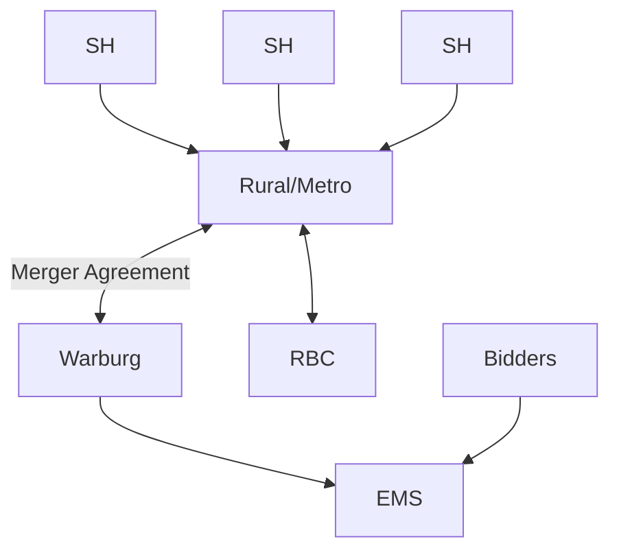

# BusOrg 16 — Aiding and Abetting

## Readings

- [[RBC Capital Markets v. Jervis (2015)]]
- [[In re Mindbody, Inc., Stockholder Litigation (2024)]]
- 8 Del. C. 144(d)(6)(C) → [[Aiding and abetting a fiduciary breach - knowing participation]], [[Controlling stockholder safe harbours - 144(b) and (c)]], [[Deal protection devices - Unocal review of merger lock-ups]]

## Notes

### 144(c)(6) and Corwin

- 144(c)(6) [?] - Explicitly allows equitable remedies to continue

### [[Corwin v. KKR Financial Holdings (2015)|Corwin]]

- [[Revlon v. MacAndrews & Forbes (1986)|Revlon]] is mainly about injunctive relief → See 144(c)(6) [?]
- Applies after 144?
    - When there is a conflicted controller → 144
    - When there is no conflict, but still a controller is present → [[Corwin v. KKR Financial Holdings (2015)|Corwin]] (?)
- **Exam note: When is [[Revlon v. MacAndrews & Forbes (1986)|Revlon]] triggered → [[Paramount v. Time (1990)|Paramount v. Time]] case helps.**
    - We are trying to answer: when does breakup/sale become inevitable and Board is/isn't maximizing shareholder value?

### Rural Metro

- Why Special Committee? Avoid breach of loyalty claims; distance decision from CEO; create more independence and less conflict with shareholders
    - Creates tradeoff between information ↔ independent
    - More independent directors = director having less stock / less motive to try and make good decisions

**Rural/Metro sale process**

- What is RBC's pitch to Warburg? To stay Warburg over [?] while disclosing he's cheating Rural? Open question. Likely a quid pro quo to get a better deal for Rural.
- Shareholders sued Directors for failure to disclose.
- NOTE! No explicit duty of loyalty for special committee → **Duty of care breach**

### Rural Metro (cont.)

- But Rural had a [[Charter exculpation of director liability|102(b)(7)]]. Yet, under Malpiede, shareholders can sue RBC for [[Aiding and abetting a fiduciary breach - knowing participation|aiding and abetting]] duty of care breach.

### Buccola thoughts

1. What could have Rural done differently? Strange how hiring IB equates to duty of care breach
2. Directors, since exculpated, actually would benefit from finding of breach of care (they themselves have stock; even if they don't, their shareholders benefit at no expense to the Rural Directors).
3. Aiding & Abetting: How can one aid another person's **negligence**.
    - Rural's duty of care breach stemmed from their negligence.
    - Still, the principal has a mens rea toward the crime, ordinarily.
    - Here, the duty of care breach had no mens rea from Rural (maybe easier to pursue aid/abetting for **duty of loyalty**)
    - *RBC testimony didn't help
    - Likely not care violation by the book; read into court [?]
4. Why not malpractice care [?]
    - Rural Metro suing RBC → doesn't happen because once deal goes through, Rural Metro is dissolved (no one on Rural Metro to do suing) + there is likely exculpation as part of deal protection
5. Aiding/Abetting
    - Stands after 144(c)(6), which allows aiding and abetting
    - 3rd parties are attractive litigation targets because they have deeper pockets

### Office hours?

- Office Hours? After Stone, is breach under [[Revlon v. MacAndrews & Forbes (1986)|Revlon]] considered duty of loyalty?

### [[In re Mindbody, Inc., Stockholder Litigation (2024)|MindBody]]

- Stollmeyer couldn't just sell all his shares → Share price would deplete drastically
- Exam note: Duty of loyalty. Stollmeyer had a conflict (wanting to cash out). → Hiding info
    - Look at [[Sinclair Oil v. Levien (1971)|Sinclair]] / Semn [?] → Related case to this in terms of application/facts/theory.
    - There was breach, but remedy was only nominal (shareholders couldn't prove price would've been higher).

### Aiding/Abetting

- Stollmeyer and Vista knew: So what? Why couldn't Vista be held for helping Stollmeyer trick Board?
    - Vista is an arms length transactor. They don't have to disclaim all the benefits that come to them
        - → Not impossible to achieve, but a higher bar.
    - Proxy materials: Vista should've spoken up about the lack of disclosure in proxy. But still, not enough. **Vista was a counterparty**.

Source photos: [[BusOrg 16 p1.jpg]], [[BusOrg 16 p2.jpg]], [[BusOrg 16 p3.jpg]]

## Signals

1. **Doctrine on the table:** Special committees, duty of care and exculpation, and aiding and abetting (Rural Metro, MindBody)
2. **Hypo, and what he was fishing for:** —
3. **Pushback on a student:** —
4. **What he called the hard case:** —
5. **What he said doesn't matter:** —
6. **Exam signal:** Exam note: when is Revlon triggered (Paramount v. Time helps); Exam note on MindBody: duty of loyalty, compare Sinclair
