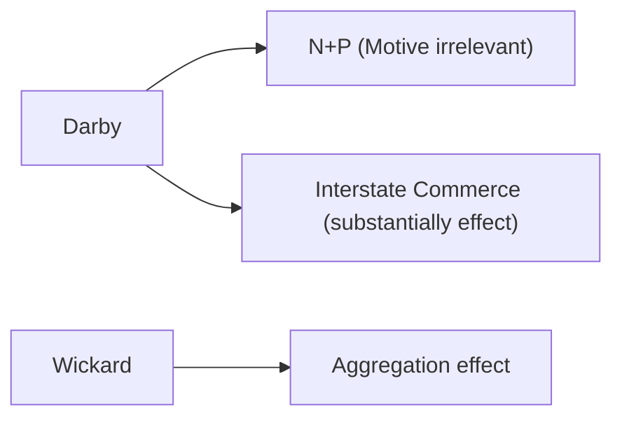

# ConLaw 18 — The Commerce Clause

## Readings

- [[Hammer v. Dagenhart (1918)|Hammer v. Dagenhart]]
- [[United States v. Darby (1941)|United States v. Darby]]
- [[Wickard v. Filburn (1942)|Wickard v. Filburn]]

## Notes

### Sovereignty

**Federal growth into state sphere**

```text
      +-------+
      | Fed.  |
      | Growth|     Fed > state via N&P and
 +----+#######+----+   interstate Commerce
 |State|#####|State|
```

- Fed > state via N&P and interstate Commerce

### [[McCulloch v. Maryland (1819)|McCulloch]]

- James Madison's liquidation → if constitution is ambiguous (which almost everything can be argued on), then we can look to practice, if:
    1. Practice is reasoned (on constitutionality)
    2. Practice is repeated / settled
- **Exam note: Baude's liquidation theory / readings → Dig deep**
- Broader holding on [[McCulloch v. Maryland (1819)|McCulloch]] is Federal supremacy and the tools the Court uses to get there ([[Enumerated powers and the Necessary and Proper Clause - Art. I § 8 cl. 18|Necessary and proper]] + Supremacy clause).

### Interstate Commerce

- Art. 1, Sec. 8, Cl. 3: Interstate Commerce
- Margin: Free speech for voting hypo [?]

### [[Hammer v. Dagenhart (1918)|Hammer]]

- Court draws a distinction between harmless/noxious goods to hold law as unconstitutional.
- Line drawing problem: looking past the facial law to understand what Congress is actually trying to "regulate".
    - Congress could respond the real motive is consumer safety or something else vs. child labor.
    - → J. Holmes sees this problem.
- Don't need incidental powers to reach Holmes position; a proper reading of the text as regulate ≈ ban → power explicitly provided by Constitution.

### [[United States v. Darby (1941)|Darby (1941)]]

- Directly regulates shipment of goods + **separately** commanded wages at those factories producing goods.
    - J. Holmes would disagree to the second point or directly at factories.
- [[United States v. Darby (1941)|Darby]]: combines N+P under interstate commerce ⟹ reaches **intrastate** commerce.
    - Uses "incidental powers" tool without actually (see [[McCulloch v. Maryland (1819)|McCulloch]]) stating it explicitly.
    - The ends = interstate commerce; even if the means are only on intrastate commerce.
- If ban is really effective, why need wage regulation separately?
    - Creates much more power based on how the law is written from the start & how Court interprets it → much broader power.
    - Margin: Pooism [?]
- Const. Amendment is circulating on child labor while this case is being decided. FDR & Admin didn't want to leave it up to chance. Consequences on both sides.
    1. Amendment = firm; unchangeable. But what happens if it doesn't happen? (alt 2 [?])
    2. SCOTUS Precedent = looser; but more achievable.
- Margin, Office Hour: 10A [?] ... "or to the people" → people decided to give to Federal under Wilson / Marshall?

### [[Wickard v. Filburn (1942)|Wickard]]

- Does Filburn really have an effect? Doesn't matter. Must approach it in an **aggregate effect** manner to see if it affects interstate commerce substantially.

**Darby and Wickard components**



### Darby side

- Consequentialist arg on market effect.
    - Line drawing problem otherwise.
- Heart Motel / Katzenbach → rational basis that Congress could believe it affects interstate commerce.

### Wickard side

- Federalism arg: insurance policy when the federal govt. does something "bad" that state can protect against.

Source photos: [[ConLaw 18 p1.jpg]], [[ConLaw 18 p2.jpg]]

## Signals

1. **Doctrine on the table:** [[McCulloch v. Maryland (1819)|McCulloch]] liquidation and federal supremacy; [[Hammer v. Dagenhart (1918)|Hammer]], [[United States v. Darby (1941)|Darby]], [[Wickard v. Filburn (1942)|Wickard]] on interstate commerce
2. **Hypo, and what he was fishing for:** Margin: "Free speech for voting hypo" [?]
3. **Pushback on a student:** —
4. **What he called the hard case:** —
5. **What he said doesn't matter:** Whether Filburn really has an effect (Wickard); motive irrelevant
6. **Exam signal:** Baude's liquidation theory / readings → Dig deep
