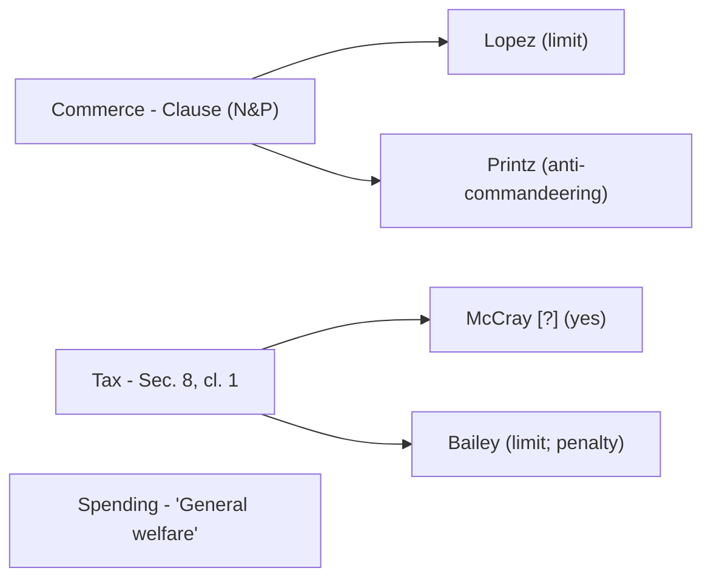

# ConLaw 22 — Spending

## Readings

- [[Madison, Veto Message on the Bonus Bill]]
- [[Hamilton, Report on Manufactures]]
- [[The Savannah Fire Debate]]
- [[South Dakota v. Dole (1987)|South Dakota v. Dole]]

## Notes

### Commerce, Tax, Spending

**Commerce, Tax, Spending and the cases under each**

- [[Bailey v. Drexel Furniture Co (1922)|Bailey]] factors: prohibitory
- [[Bailey v. Drexel Furniture Co (1922)|Bailey]] factors: scienter
- [[Bailey v. Drexel Furniture Co (1922)|Bailey]] factors: Regulating Agency
- [[Bailey v. Drexel Furniture Co (1922)|Bailey]] factors: prescribed code of conduct
- [[United States v. Lopez (1995)|Lopez]] (limit) and [[Printz v. United States (1997)|Printz]] (anti-commandeering) sit under the Commerce Clause (N&P)
- McCray [?] (yes) and Bailey (limit; penalty) sit under Sec. 8, cl. 1 (tax); the McCray reading is uncertain, probably [[McCray v. United States]]

### Spending

- Provide for common defence and **"general welfare"**
    - Madison: limited to (1) only the laying of taxes and (2) content is fixed by enumeration (at least must be necessary and proper; can use interstate commerce too)

### [[South Dakota v. Dole (1987)|Dole (1987)]]

- Court has come around to the Hamiltonian view of the spending power
- Could Congress set a nation-wide age via the Commerce clause?
    - Would have to get there via substantial effect on interstate commerce
        - Must be economic activity ([[United States v. Lopez (1995)|Lopez]]), but a overarching/aggregation regulation related to commerce would solve ([[Gonzales v. Raich (2005)|Raich]])
- Even so, there would only be a federal crime. Under [[Printz v. United States (1997)|Printz]] + Anti-commandeering, States can still keep it legal.

### Test

1. General welfare
1. Unambiguous
1. Germaneness
1. Not unconstitutional (can't make States to do something unconstitutional) → this is clearly not viable [?]
- Overall 5th limit: **No Coercion**

### [[South Dakota v. Dole (1987)|Dole (1987)]] - O'Connor

- Not germane/relatedness → Condition (min drinking age) is not related to the grant being withheld (highway construction).
- **Categorical limit offered:** Congress can only impose requirements on where to spend the money; can't impose separate regulations/quid pro quo.
    - Still, federal program can be drawn specifically → How does this get past spending
- After Dole, and before [[NFIB v. Sebelius (2012)|NFIB]], unambiguous prong becomes leading prong → turns into almost a [[Nondelegation - Art. I § 1 and the intelligible principle|non-delegation doctrine]] applied, actually coming into life

### Recent limit

- Can't create a spending clause cause of action 3rd parties → Can't make a condition into a federal law. Remains state's prerogative to enforce.

### Office hours (margin)

- **Office hours:** (J. Blackmun) [[Garcia v. San Antonio Metropolitan Transit Authority (1985)|Garcia]]/political process, O'Connor categorical limit

Source photos: [[ConLaw 22 p1.jpg]], [[ConLaw 22 p2.jpg]]

> [!warning] Uncertain readings flagged at capture
> - `McCray [?] (yes)` — handwriting reads like 'Mclae'; probably McCray, not certain
> - `this is clearly not viable [?]` — margin note beside Dole prong 4 is hard to read; first word 'this' and last word 'viable' uncertain

## Signals

1. **Doctrine on the table:** Spending power: Dole test (general welfare, unambiguous, germaneness, not unconstitutional) plus overall limit of no coercion; O'Connor's germaneness and categorical-limit views
2. **Hypo, and what he was fishing for:** Could Congress set a nation-wide age via the Commerce clause? (what he was fishing for not stated)
3. **Pushback on a student:** —
4. **What he called the hard case:** —
5. **What he said doesn't matter:** —
6. **Exam signal:** —
